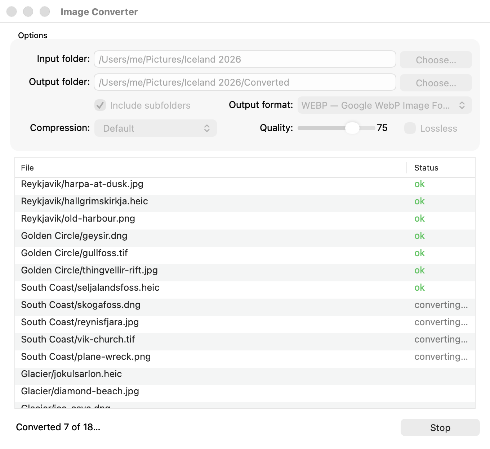
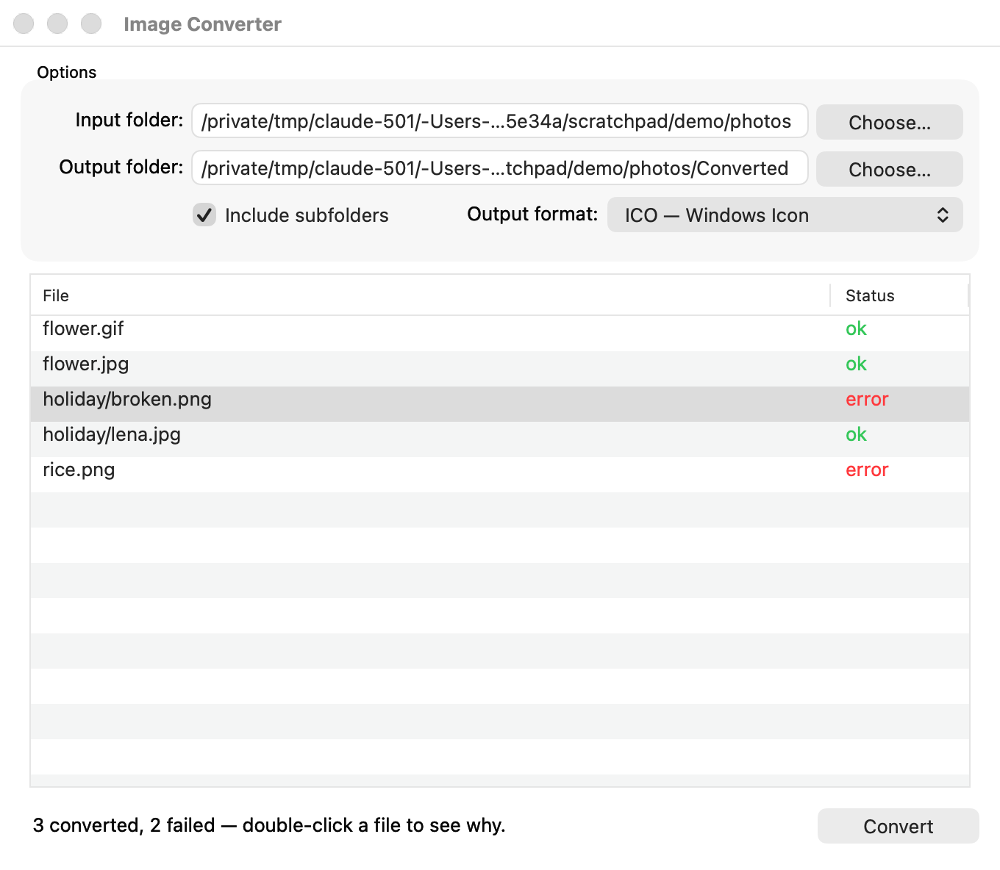
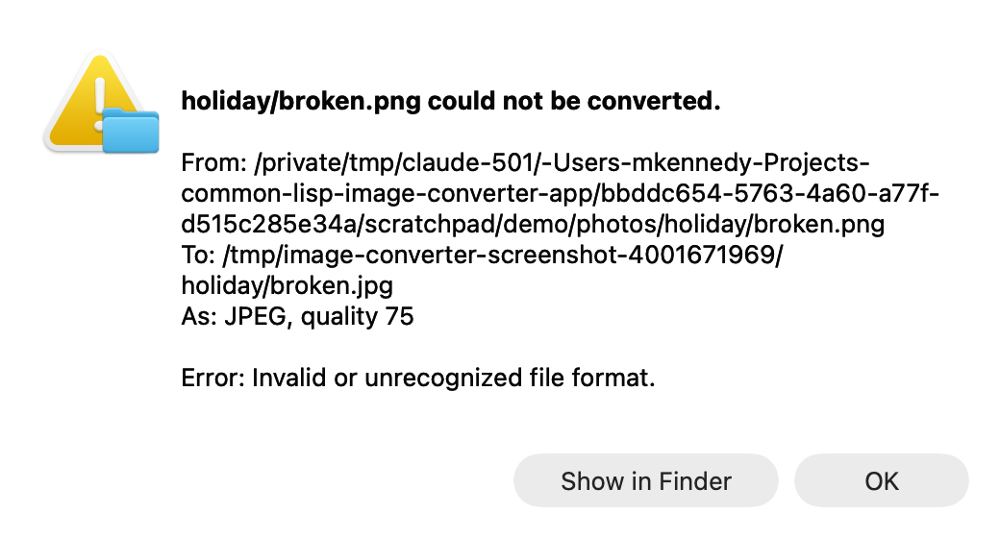

# Image Converter

A macOS application, written in Common Lisp, that converts a folder of images
to another format. Choose an input folder and an output folder, whether to look
in subfolders, and a format; the window lists the images it found, and Convert
fills in each one's status.

Built with SBCL, [objc](https://github.com/lispnik/objc) for AppKit,
[asdf-macos-app](https://github.com/lispnik/asdf-macos-app) for the bundle,
[im](https://github.com/lispnik/im) for reading and writing images, FiveAM for
the tests and ocicl for the dependencies.



## Using it

- **Input folder** — the images to convert. Choose… opens a folder panel, or
  type a path (`~` works) and press Return.
- **Output folder** — where the converted images go. Choosing an input folder
  first suggests a `Converted` folder inside it. Subfolders of the input are
  recreated here.
- **Include subfolders** — list the images in every folder below the input
  too. An output folder inside the input folder is left out, so converting
  twice does not convert the first run's output.
- **Output format** — every format IM has registered and can write, asked of
  IM when the application starts. With the Homebrew build of tecgraf-im 2.3.0:
  HEIF, AVIF, WEBP, JXL, EXR, FITS, TIFF, JPEG, PNG, GIF, BMP, RAS, ICO, PNM,
  PFM, HDR, QOI, KRN, LED, SGI, PCX and TGA. Camera raw files (DNG, CR2, NEF,
  ARW and others, through LibRaw) are read and converted, but cannot be
  written, so CAMRAW is not offered.
- **Compression** — the format's compressions that IM can write: TIFF's LZW,
  JPEG, DEFLATE and the rest, BMP's RLE, PNM's ASCII. Default is what IM uses
  when none is asked for (LZW for TIFF). One that takes only some images says
  so — `CCITTFAX4 (black and white only)` — and choosing it makes every image
  that. Formats with one compression show it and offer no choice.
- **Quality** — 0 to 100, for JPEG (75 unless changed), HEIF and AVIF (80),
  WEBP (75), JXL (90), and TIFF with JPEG compression.
- **Lossless** — HEIF, AVIF, WEBP and JXL; quality is then not used.

Each format keeps its own compression, quality and lossless setting, so
choosing TIFF and then JPEG again finds JPEG as you left it.

The list shows each image's path, relative to the input folder, and a status:
blank until it is converted, then **ok** or **error**. **Double-click** a file
to see where it came from, where it went, and the error, or what had to be
changed to fit the format. Files are converted several at once, one per
processor, and the ones in progress say `converting…`. Convert becomes Stop
while it runs; Stop finishes the files in hand and starts no more, and so does
quitting. The options are
remembered between launches.





### Fitting an image to a format

Formats store different kinds of image: a GIF must be a palette image, a JPEG
cannot be one, EXR, HDR and PFM hold only floating-point samples, KRN only grayscale, and
TIFF with a fax compression only black and white. IM
refuses to write an image in a shape its format does not take, so a plain load
and save fails for about a third of everyday pairs. Each image is therefore
converted to the first shape the format accepts — its own, then without alpha,
then RGB, palette, grayscale and so on — and the details say what was changed:

> Converted from RGB colour (8-bit) to palette colour (8-bit) because GIF
> cannot store the original.

### Nothing is written over

- Two images that would land on one name — `photo.png` and `photo.jpg`, both to
  TIFF — become `photo-png.tif` and `photo-jpg.tif`.
- An output never replaces an input. Converting a folder of PNGs to PNG in
  place writes `photo-png.png`; the status line warns when the output folder
  *is* the input folder.
- Converting in place again does not convert the first run's output. Each file
  written is marked, in an extended attribute
  (`org.lispnik.image-converter.source`), with the file it came from, and a
  marked file is left out of the list when that file is in the list too. A
  folder of converted files chosen on its own is converted like any other.
- Folders are compared after symbolic links are resolved, so `/tmp/x` and
  `/private/tmp/x` are recognised as the same folder.

Existing files in the output folder with the planned names *are* replaced, as
you would expect when converting the same folder again.

## Building

You need SBCL, ocicl, a `tecgraf-im` with the uninitialised-memory fixes (newer
than 2.2.1; see Notes), and checkouts of
[im](https://github.com/lispnik/im), which is not in the ocicl registry, and
[asdf-macos-app](https://github.com/lispnik/asdf-macos-app), whose pinned
release does not yet set up the bundle's library path early enough for im (see
Notes). By default both are looked for beside this directory, at `../im` and
`../asdf-macos-app`.

```sh
make deps    # restore the dependencies ocicl.csv pins, into ./ocicl/
make test    # the FiveAM suite; fails while the IM in use leaks memory into files
make run     # run from source, unbundled
make app     # build/Image Converter.app
make icon    # draw res/icon.png again
make screenshot                     # doc/converting.png, staged
make screenshot INPUT=/a/folder/of/images FORMAT=ICO   # and doc/window.png, doc/details.png
```

```sh
make app IM_DIR=~/src/im                 # im from somewhere else
make app OBJC_DIR=~/Projects/common-lisp/objc MACOS_APP_DIR=~/src/asdf-macos-app
make app MACOS_APP_DIR=                  # the asdf-macos-app ocicl.csv pins
```

The Makefile runs SBCL without your init file and with a source registry of
this tree (plus `IM_DIR`) alone, so a dependency missing from `ocicl.csv` fails
the build rather than resolving from elsewhere on your machine.

The bundle carries its own copies of IM and everything IM links against
(libtiff, libjpeg, libpng, libheif and its codecs, libwebp, libjxl, OpenEXR,
CFITSIO, LibRaw, …) in
`Contents/Frameworks`, so it runs on a Mac without Homebrew. It is signed ad
hoc unless `MACOS_SIGNING_IDENTITY` names a certificate; put that in
`local.mk`, which is not committed.

### Releasing

A release is a disk image of the bundle, both signed with a Developer ID and
notarised. `local.mk` (not committed) names the certificate and a notary
profile stored with `xcrun notarytool store-credentials`:

```make
MACOS_SIGNING_IDENTITY = Developer ID Application: Your Name (TEAMID)
NOTARY_PROFILE = image-converter
```

```sh
make app             # signed with the hardened runtime
make release         # release-check, notarize, dmg, notarize-dmg
```

`make release-check` refuses a bundle signed ad hoc and one whose runtime links
anything outside the system. The runtime is the building SBCL's, and
Homebrew's links Homebrew's libzstd for core compression: build a release with
an SBCL configured `--without-sb-core-compression`. The disk image is
`dist/Image-Converter-<version>.dmg`, the version taken from
`image-converter-app.asd`.

### Checking the bundle from a script

Nothing can click in a script, so the application has a self test: given a
folder, it converts it as soon as the window is up and quits when done, with
each file's result in `~/Library/Logs/Image Converter.log`.

```sh
open -W --env IMAGE_CONVERTER_SELFTEST=$PWD/samples \
        --env IMAGE_CONVERTER_SELFTEST_FORMAT=HEIF \
        "build/Image Converter.app"
```

The output goes to a new temporary folder (named in the log) unless
`IMAGE_CONVERTER_SELFTEST_OUTPUT` says otherwise.
`IMAGE_CONVERTER_SELFTEST_COMPRESSION`, `_QUALITY` and `_LOSSLESS=1` set the
format's settings. The self test neither reads
nor changes the options remembered from the window.

## Layout

| Path | Contents |
|---|---|
| `src/formats.lisp` | The formats IM can write, as the drop-down shows them |
| `src/scan.lisp` | Finding the images in a folder; canonical paths |
| `src/mark.lisp` | Marking each file written with its original, so a second run in place leaves it out |
| `src/convert.lisp` | One file into one format, fitting the image to it |
| `src/batch.lisp` | The list of files, where each goes, and how it went |
| `src/macos/` | The window, the menu and `main` |
| `tests/` | FiveAM: formats, scanning, conversion, planning, marking, IM leaking memory into files, and the real window driven without clicks |
| `tools/` | The icon, drawn pixel by pixel with IM, and the screenshot tool |

Conversion runs on SBCL threads, one per processor (`start-batch` in
`src/batch.lisp`). The workers call IM and nothing else: the main thread looks
at what they have finished ten times a second, and is the only one that
touches AppKit or the Objective-C bridge. `IMAGE_CONVERTER_WORKERS=n` sets how
many run at once.

## Notes

- **IM's libraries in the bundle.** `im` reopens its libraries in an image
  restore hook. asdf-macos-app used to add `Contents/Frameworks` to CFFI's
  search path only afterwards, in its toplevel, so the application loaded
  Homebrew's copies beside the bundled ones, and HEIF and AVIF went missing
  from the format list. asdf-macos-app now does it in a restore hook that runs
  before all the others. Check with `vmmap <pid> | grep dylib`: everything IM
  should come from `Contents/Frameworks`.
- **ICO** holds images up to 255×255 pixels; a larger one is an error that
  says so rather than IM's "invalid or unsupported image data".
- **Alpha.** IM reports that every format can store alpha, then JPEG and PNM
  drop it silently. The written file's header is read back, and the details
  say when the alpha channel was lost.
- **Dropping alpha.** Not with `im:convert-to-bitmap`: for 8-bit images it is
  IM's colour space conversion, which copies nothing when the space is
  unchanged, and an RGBA image came out black. The image is duplicated and its
  alpha plane removed instead. The tests compare samples, not only sizes.
- **LED** is said to store RGB, and its writer keeps only the red channel. A
  colour image that reads back gray counts as refused, and is written as a
  palette instead.
- **Threads, and not Grand Central Dispatch.** A stock SBCL stops the world
  for a collection by signalling every thread in Lisp, and macOS will not
  signal a GCD worker, so Lisp running on several of them at once dies at the
  first collection (see `examples/gcd.lisp` in objc). The work is IM's, in C,
  and SBCL threads run foreign calls in parallel, so GCD would buy nothing.
- **IM on several threads.** Safe but for three static buffers, found by
  converting 384 files on one thread and on eight and comparing the decoded
  images: the format and compression lists (read once and cached), the RGB to
  palette quantizer and the PNG writer's text-chunk count (both under
  `*im-lock*`, `src/formats.lisp`).
- **IM 2.2.1 writes memory it never set into files**, where it can carry
  anything the application had in memory: the padding at the end of each line
  of a BMP, ICO, PCX or Sun raster (heap), the unused palette entries of an
  indexed PCX (stack), and the GIF interlaced flag. The decoded images are
  correct, which is how it went unnoticed. It is fixed in lispnik/tecgraf-im,
  whose `test/test_uninit.cpp` writes every format twice over differently
  filled memory and requires identical files. Since the bundle carries the IM
  it is built against, `tests/leak-tests.lisp` fails while that IM is an
  unfixed one; `make test` runs it with `MallocScribble=1`, which makes macOS
  fill every new heap block with 0xAA so that a byte IM did not set shows.
- **Floating-point formats** (EXR, HDR, PFM) are written with 8-bit samples
  scaled to 0 to 1, white being 1. They were once written as 0 to 255, and
  nearly every picture opened white. The values are the sRGB ones, not made
  linear, so a viewer that treats EXR as linear light shows them lighter.
- **`imFormatInfo` and CAMRAW.** IM copies a format's description and
  extensions into the caller's buffers with no length, and documents 50
  characters as the most either holds; tecgraf-im 2.3.0's CAMRAW lists 156
  characters of extensions. `im:format-info` passes buffers of 1024 bytes,
  and the fork lists fewer extensions (see its `CHANGES.md`).
- **Quality** has no name common to the formats: each driver reads an image
  attribute of its own (`JPEGQuality`, `Quality`, `Lossless`) and ignores the
  rest. `*quality-attributes*` in `src/convert.lisp` lists them.
